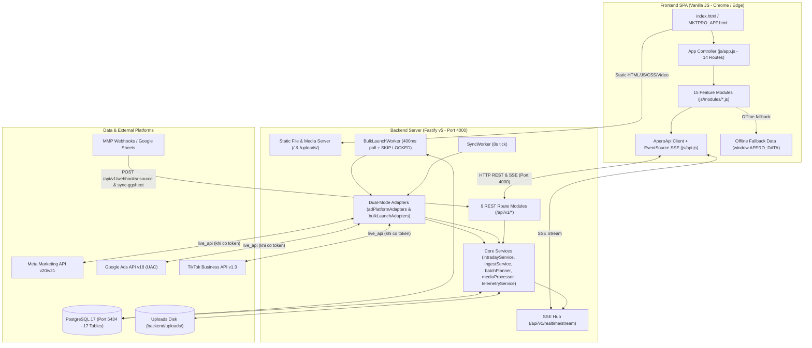
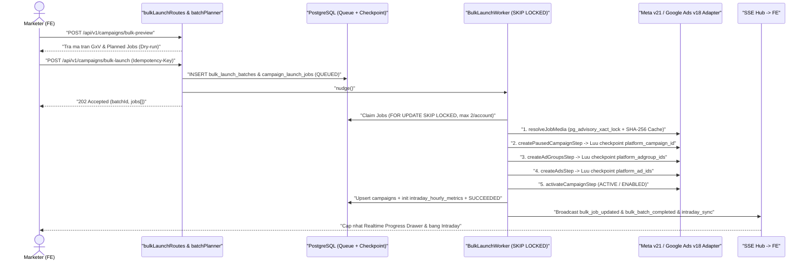

# Tài Liệu Kiến Trúc Hệ Thống Web (Frontend & Backend) — Apero MktPro

**Phạm vi:** Toàn bộ kiến trúc Frontend (Vanilla JS SPA) & Backend (Node.js + TypeScript + Fastify + PostgreSQL) hiện có trong thư mục `apero-mktpro/`.  
**Cập nhật:** 20/11/2026

---

## 1. Tổng Quan Hệ Thống & Công Nghệ (Tech Stack)

Apero MktPro được thiết kế theo mô hình **Unified Modular Monolith** tối giản dependency nhằm đạt độ trễ thấp cho Realtime Report & luồng tạo chiến dịch hàng loạt, đồng thời hỗ trợ **Offline Fallback** khi mở file HTML độc lập.

| Tầng | Công nghệ / Thành phần | Ghi chú kỹ thuật |
| :--- | :--- | :--- |
| **Frontend (FE)** | **Vanilla JS (ES6+) + HTML5 + CSS3** | Không cần Node bundler (Webpack/Vite); 19 file JS gắn namespace lên `window.*`; biểu đồ SVG/Canvas tự dựng trong `js/charts.js` |
| **Offline Bundle** | **PowerShell Bundler (`build_bundle.ps1`)** | Gộp `index.html` + `css/style.css` + 19 file JS thành duy nhất 1 file `MKTPRO_APP.html` |
| **Backend (BE)** | **Node.js + TypeScript + Fastify v5** | Chỉ 5 runtime dependencies (`fastify`, `@fastify/cors`, `@fastify/static`, `pg`, `dotenv`); chạy trực tiếp bằng `tsx` tại cổng `4000` |
| **Realtime Transport** | **Server-Sent Events (`EventSource`)** | Endpoint `/api/v1/realtime/stream` đẩy sự kiện realtime một chiều từ Server xuống Browser qua `SseHub` |
| **Database** | **PostgreSQL 17 (`postgres:17-alpine`)** | Chạy trong Docker container `apero-mktpro-db` cổng `5434`, truy vấn SQL thuần qua `pg.Pool` (`max: 15`) |
| **Media Storage** | **Local Disk + Public URL Proxy** | Lưu file binary upload (tối đa `250MB`) tại `backend/uploads/creatives/`, phục vụ qua `/uploads/` |

### Sơ Đồ Kiến Trúc Tổng Thể



---

## 2. Cấu Trúc Thư Mục Toàn Dự Án (`apero-mktpro/`)

```text
apero-mktpro/
├── index.html                          # Shell HTML chính (Dark/Light theme, Sidebar 4 nhóm, Header)
├── MKTPRO_APP.html                     # Bản bundle 1-file độc lập được sinh từ build_bundle.ps1
├── build_bundle.ps1                    # Script gộp index.html + CSS + 19 file JS thành MKTPRO_APP.html
├── verify_bundle.ps1                   # Script kiểm tra tính toàn vẹn của file MKTPRO_APP.html
├── docker-compose.yml                  # Dựng PostgreSQL 17 container (apero-mktpro-db, cổng 5434)
├── TAI_LIEU_CHUAN_BI_PRODUCTION.md     # Tài liệu chuẩn bị hạ tầng, thông số, Token & API Key Production
├── TAI_LIEU_KIEN_TRUC_HE_THONG.md      # Tài liệu kiến trúc FE/BE (file hiện tại)
├── css/
│   └── style.css                       # Toàn bộ Design System, Dark/Light tokens, bảng, modal, pill realtime
├── js/
│   ├── data.js                         # Dữ liệu mẫu & Fallback Data (window.APERO_DATA) + biến cấu hình
│   ├── api.js                          # HTTP Fetch Client + Native SSE EventSource (window.AperoApi)
│   ├── charts.js                       # Thư viện vẽ biểu đồ SVG/Canvas thuần không phụ thuộc ngoài
│   ├── app.js                          # Controller trung tâm: Router 14 trang, Currency, Search Ctrl+K, Toast
│   └── modules/                        # 15 module nghiệp vụ chia làm 2 nhóm (nối DB thật & phân tích tĩnh)
│       ├── intraday.js                 # [Live BE+SSE] Intraday Report (9 KPIs, Hourly Chart, Tree 3 cấp)
│       ├── realtimeEngine.js           # [Live BE+SSE] Engine đồng bộ SSE & Telemetry Monitor Modal
│       ├── templates.js                # [Live BE] App / Page / Campaign / Ad Copy Template Management
│       ├── tactics.js                  # [Live BE] Rule Engine Tactic Management (Bật/Tắt & Tạo mới)
│       ├── packages.js                 # [Live BE] Package Builder (Khớp App + Cam + Ad + Page + Account + Tactics)
│       ├── creatives.js                # [Live BE+SSE] Creative Hub, Upload MP4 thật & Bulk Launch Wizard Drawer
│       ├── dataManagement.js           # [Live BE] Nhập dữ liệu thật (Form / CSV / JSON / Google Sheets / Webhook Test)
│       ├── admin.js                    # [Live BE] Quản lý Ad Accounts, gắn Access Token & nút Sync thủ công
│       ├── cutoff.js                   # [Analytics UI] Marketing Cutoff Report
│       ├── cohort.js                   # [Analytics UI] Cohort ROAS D0–D30 Heatmap
│       ├── channel.js                  # [Analytics UI] Channel Breakdown Report
│       ├── productMetrics.js           # [Analytics UI] Product Metrics Overview
│       ├── compareVersion.js           # [Analytics UI] So sánh phiên bản App (A/B App Version)
│       ├── monetization.js             # [Analytics UI] Báo cáo doanh thu Ads/IAP (Monetization)
│       └── business.js                 # [Analytics UI] Báo cáo P&L doanh nghiệp
└── backend/
    ├── .env / .env.example             # Biến môi trường: PORT, DATABASE_URL, TIMEZONE, FX, FEE, SYNC_WORKER_*
    ├── package.json & tsconfig.json    # Scripts dev/start/build/verify/verify:bulk
    └── src/
        ├── config.ts                   # Nạp .env & cấu hình mặc định
        ├── server.ts                   # Bootstrap Fastify, DB migration, binary parser 250MB, static & routes
        ├── verify.ts                   # E2E Verification cho Realtime Report (10 checks)
        ├── verifyBulk.ts               # E2E Verification cho Bulk Campaign Creation (9 checks)
        ├── db/
        │   ├── pool.ts                 # Kết nối pg.Pool, OID type parsers & runner chạy schema/seed khi khởi động
        │   ├── schema.sql              # 7 bảng lõi (Products, Marketers, Ad Accounts, Campaigns, Hourly Metrics...)
        │   ├── schema_bulk.sql         # 10 bảng Bulk Launch & Creatives + mở rộng bảng campaigns
        │   ├── seed.ts                 # Khởi tạo dữ liệu mẫu T-3 -> T0 (00:00-23:00) nếu DB trống
        │   └── seedBulk.ts             # Khởi tạo Creatives, Templates, Tactics, Packages mẫu nếu bảng trống
        ├── routes/                     # 9 file định tuyến REST & SSE dưới prefix /api/v1/*
        │   ├── intraday.ts             # Report KPI/Tree/Hourly, Export CSV UTF-8 BOM, Toggle Status ON/OFF
        │   ├── ingest.ts               # Webhooks (:source), Nhập thủ công, Import CSV/JSON, Google Sheets Sync
        │   ├── realtime.ts             # SSE Stream, Telemetry Logs, Toggle/Trigger SyncWorker
        │   ├── adAccounts.ts           # CRUD Ad Accounts (che token) & Sync thủ công theo Account
        │   ├── templates.ts            # CRUD Application / Campaign / Ads / Page Templates
        │   ├── tactics.ts              # CRUD Automation Tactics
        │   ├── packages.ts             # CRUD Packages kèm cross-validation giữa kênh & template
        │   ├── creatives.ts            # Danh sách, Upload Binary MP4/JSON, AI Policy Re-check
        │   └── bulkLaunch.ts           # Dry-run Preview, Submit Batch (Idempotency), Track Progress & Retry Jobs
        ├── services/
        │   ├── intradayService.ts      # Truy vấn & tổng hợp động 9 KPI, Grand Total, cây 3 cấp, xuất CSV
        │   ├── ingestService.ts        # Chuẩn hóa & upsert atomic (Delta / Absolute) vào PostgreSQL + SSE broadcast
        │   ├── telemetryService.ts     # Đọc/ghi system_settings & nhật ký telemetry_logs
        │   ├── sseHub.ts               # Quản lý kết nối EventSource, heartbeat 20s & broadcast sự kiện
        │   ├── mediaProcessor.ts       # Lưu file đĩa, tính SHA-256 & đọc box mvhd/tkhd của MP4 lấy duration/size
        │   └── batchPlanner.ts         # Cross-validate Package, Copy UAC, tính ma trận G×V & sinh tên chiến dịch
        ├── adapters/
        │   ├── adPlatformAdapters.ts   # Dual-mode Sync Report (live_api Facebook/TikTok vs server_sandbox)
        │   └── bulkLaunchAdapters.ts   # Dual-mode Bulk Launch (Meta Graph v21.0 & Google Ads v18 UAC vs Sandbox)
        ├── workers/
        │   ├── syncWorker.ts           # Vòng lặp 8s xoay vòng kéo dữ liệu từng Ad Account & MMP
        │   └── bulkLaunchWorker.ts     # Worker tiêu thụ Queue SKIP LOCKED theo Saga 6 bước có Checkpoint
        └── utils/
            └── time.ts                 # Tiện ích múi giờ Asia/Ho_Chi_Minh, parse tiền/ngân sách
```

---

## 3. Kiến Trúc Frontend (FE — Vanilla JS Modular SPA)

### 3.1. Cơ chế Nạp & Khởi tạo (`index.html` & `js/app.js`)
Frontend hoạt động hoàn toàn không cần bước biên dịch npm (`zero-build`). Thứ tự `<script>` trong [index.html](file:///E:/Code/website%20mkt/apero-mktpro/index.html#L273-L295) và [build_bundle.ps1](file:///E:/Code/website%20mkt/apero-mktpro/build_bundle.ps1#L40-L60) được khóa cứng theo dependency graph:
1. `js/data.js`: Tạo dữ liệu mẫu offline `window.APERO_DATA` (sản phẩm, bộ lọc, thông báo, fallback tables).
2. `js/api.js`: Khởi tạo `window.AperoApi` (REST + SSE client).
3. `js/charts.js`: Cung cấp hàm vẽ biểu đồ line/bar/area cho các trang báo cáo.
4. `js/modules/*.js` (15 module): Mỗi file đăng ký lên `window.<ModuleName>` với giao diện thống nhất `{ render(), initCharts?(), ... }`.
5. `js/app.js`: Khởi tạo `App.init()` — khôi phục Theme (`localStorage.apero_theme`), gắn phím tắt toàn cục (`Ctrl+K` Search, `Esc`), khởi chạy `RealtimeEngine.init()` để nối SSE, và render route mặc định `intraday`.

### 3.2. Định tuyến SPA (14 Routes) & Quản lý Trạng thái Toàn cục (`App`)
- **Router (`App.setRoute` / `App.renderRoute`)**: Điều hướng không tải lại trang bằng cách thay `innerHTML` của `#mainContentArea`, đồng bộ active state trên Sidebar, cập nhật Breadcrumb và gọi hàm `initCharts()` sau `60ms`.
- **14 Routes hiện có**:
  - *Reports & Analytics*: `intraday`, `cutoff`, `cohort`, `channel`, `product-metrics`, `compare-version`, `monetization`, `business`.
  - *Campaign Automation*: `templates`, `tactics`, `packages`, `creatives`.
  - *Data & System*: `data-management`, `admin`.
- **Global State trên Header**:
  - **Product Switcher** (`All`, `AIP922`, `AIP886`, `AIP919`, `AAP885`, `AAP858`) đồng bộ trực tiếp bộ lọc trên `IntradayModule`.
  - **Currency Toggle** (`VND` $\leftrightarrow$ `USD`) gọi lại `renderRoute()` để quy đổi toàn bộ bảng & KPI theo tỷ giá `exchangeRateVnd` từ Backend (`25,718`).
  - **Realtime Pill (`#realtimeHeaderBadge`)**: Hiển thị trạng thái `LIVE SYNC` / `PAUSED` / `OFFLINE` và mở **Telemetry Modal** khi click.

### 3.3. Tầng Giao Tiếp API & Cơ Chế Offline Fallback (`js/api.js`)
- **Tự nhận diện môi trường (`DEFAULT_BASE`)**:
  - Nếu đang mở trên `http://...:4000` (do Fastify phục vụ trực tiếp), `baseUrl = ''` (same-origin, không dính CORS).
  - Nếu mở qua Live Server khác port hoặc mở trực tiếp file `MKTPRO_APP.html` (`file://`), tự động trỏ tới `http://localhost:4000`.
- **Offline Fallback**: Mọi phương thức `request()` đặt timeout `15s` và cập nhật cờ `isBackendOnline`. Nếu Backend chưa bật, các màn hình sẽ bắt lỗi an toàn và rơi về dữ liệu tĩnh trong `window.APERO_DATA` thay vì treo giao diện.
- **Event Bus nội bộ trên SSE (`connectRealtimeStream`)**: Lắng nghe `/api/v1/realtime/stream` và phân phối 5 sự kiện tới mọi module đã đăng ký qua `AperoApi.on(...)`:
  - `connected`: Kết nối SSE thành công kèm trạng thái `SyncWorker`.
  - `intraday_sync`: Có bản ghi metrics mới $\rightarrow$ `RealtimeEngine` & `IntradayModule` tự động làm mới KPI, biểu đồ 24h và bảng cây.
  - `worker_status`: Trạng thái bật/tắt `SyncWorker` thay đổi.
  - `bulk_job_updated`: Cập nhật tiến trình từng step (`RESOLVING_MEDIA`, `CREATING_CAMPAIGN`...) của Job tạo camp trên Drawer của `CreativesModule`.
  - `bulk_batch_completed`: Hoàn tất cả Batch tạo camp hàng loạt.

### 3.4. Phân Nhóm 15 Frontend Modules (`js/modules/`)

| Nhóm kết nối | Module (`js/modules/`) | Chức năng & Tích hợp Backend |
| :--- | :--- | :--- |
| **Full-Stack DB + SSE** | `intraday.js`, `realtimeEngine.js` | Nối `/api/v1/intraday/report`, xuất CSV thật, bật/tắt camp (`PATCH`), auto-refresh KPI/Chart khi SSE `intraday_sync` tới, mở Telemetry Modal xem log thật & bật/tắt SyncWorker |
| **Full-Stack Bulk Launch** | `creatives.js`, `packages.js`, `templates.js`, `tactics.js` | Upload file MP4 binary thật, re-check AI policy, CRUD Templates/Tactics/Packages, mở Bulk Launch Wizard chọn ma trận `(Creatives × Packages)`, xem Dry-run Preview, Launch & theo dõi tiến độ từng job realtime qua SSE + Retry Job lỗi |
| **Full-Stack Ingestion & Ops** | `dataManagement.js`, `admin.js` | Form tạo camp thủ công, Upload CSV, Paste JSON, Sync link Google Sheets, test bắn Webhook mẫu; quản lý Ad Accounts, lưu Access Token & bấm Sync thủ công |
| **Analytics UI (Static Data)** | `cutoff.js`, `cohort.js`, `channel.js`, `productMetrics.js`, `compareVersion.js`, `monetization.js`, `business.js` | Render đầy đủ giao diện báo cáo nâng cao (Heatmap Cohort D0–D30, Cutoff, P&L, Version Compare, Mediation) từ `window.APERO_DATA` & `charts.js` |

---

## 4. Kiến Trúc Backend (BE — Node.js + TypeScript + Fastify + PostgreSQL)

### 4.1. Luồng Khởi Động & Cấu Hình (`server.ts`, `pool.ts`, `config.ts`)
1. `config.ts` nạp `.env` (`PORT=4000`, `DATABASE_URL`, `TIMEZONE=Asia/Ho_Chi_Minh`, `SYNC_WORKER_INTERVAL_MS=8000`, `EXCHANGE_RATE_VND=25718`, `PLATFORM_FEE_RATE=0.0155`).
2. `ensureDatabaseReady()` trong `pool.ts`:
   - Cấu hình Type Parser PostgreSQL: `DATE (1082)` giữ nguyên chuỗi `YYYY-MM-DD`, `NUMERIC (1700)` sang `float`, `INT8 (20)` sang `integer`.
   - Chạy idempotent SQL từ `schema.sql` rồi `seedIfEmpty()`, tiếp tục chạy `schema_bulk.sql` rồi `seedBulkIfEmpty()` (tạo dữ liệu 4 ngày `T-3` $\rightarrow$ `T0` theo từng giờ `00–23` và bộ template/creative mẫu nếu DB trống).
3. `server.ts` đăng ký binary content parser (`/^video\/|^image\/|^application\/octet-stream/`, giới hạn `250MB`), `@fastify/cors`, 9 nhóm routes (`/api/v1/*`), 2 endpoint static (`/uploads/` cho media và `/` cho Frontend), sau đó khởi động `syncWorker` và `bulkLaunchWorker`.

### 4.2. Thiết Kế Cơ Sở Dữ Liệu PostgreSQL (17 Bảng)

#### A. Nhóm Bảng Core & Realtime Intraday Report (`schema.sql` — 7 bảng)
1. **`products`**: Danh mục App (`AIP922`, `AIP886`...), phân hệ `division` (`AIP`/`AAP`), `package_name`.
2. **`marketers`**: Danh sách UA Marketer (`HoangNC`, `TrangDQ`...).
3. **`ad_accounts`**: Tài khoản quảng cáo (`Facebook`, `TikTok`, `Google Ads`, `Mintegral`), lưu `access_token` và `api_config` (JSONB chứa `login_customer_id`, `developer_token`, `max_concurrent_jobs`, `rate_limited_until`).
4. **`campaigns`**: Danh sách chiến dịch (bổ sung từ `schema_bulk.sql` các cột liên kết `package_id`, `source_job_id`, `creative_ids[]`, `tactic_ids[]`).
5. **`intraday_hourly_metrics`**: Kho dữ liệu chuỗi thời gian cốt lõi — khóa chính `(metric_date, hour_slot, campaign_id, country)` với `CHECK (hour_slot BETWEEN 0 AND 23)`. Mọi nguồn ghi đều đi qua `INSERT ... ON CONFLICT DO UPDATE` (cộng dồn cho Delta mode hoặc ghi đè cho Absolute mode).
6. **`telemetry_logs`**: Lịch sử đồng bộ webhook, API sync, control camp (`source`, `status_code`, `latency_ms`, `message`, `payload_summary`).
7. **`system_settings`**: Cấu hình động dạng Key-Value (`ggsheet_csv_url`, v.v.).

#### B. Nhóm Bảng Bulk Campaign Automation (`schema_bulk.sql` — 10 bảng)
8. **`creatives`**: Kho video/ảnh (`sha256_hash`, `storage_path`, `public_url`, metadata `duration_sec`, `width`, `height`, `aspect_ratio`, trạng thái policy Meta/TikTok/Google, `youtube_video_id`, bộ đếm `campaign_success_count` / `campaign_failed_count`).
9. **`ad_account_media_cache`**: Cache chống upload trùng lặp với khóa `UNIQUE (channel, scope_key, creative_sha256)`. Hỗ trợ 3 phạm vi: `Facebook` (`scope_key = ad_account_id`), `YouTube` (`scope_key = youtube_channel_id`), và `GoogleAsset` (`scope_key = ad_account_id`).
10. **`app_templates`**: Store App (`store_type`, `platform_app_id`, `bundle_id`, `store_url`).
11. **`page_templates`**: Danh tính hiển thị Facebook (`page_id`, `instagram_actor_id`).
12. **`campaign_templates`**: Cấu hình ngân sách (`budget_amount`, `budget_currency`, `budget_level`), đấu thầu (`performance_goal`, `convert_event`, `roas_goal`, `target_cpa`), khối lượng ma trận (`ad_group_volume`, `creative_volume`) và targeting (`country_codes`, `language_codes`).
13. **`ad_templates`**: Bộ text quảng cáo lưu JSONB (`copy_payload`) cho cả Facebook multi-copy và Google Ads UAC Copy Groups (`groups[].headlines`, `descriptions`).
14. **`tactics`**: Quy tắc tự động tối ưu sau khi camp chạy (`rules_payload`).
15. **`packages`**: Thực thể ghép hoàn chỉnh `App + Campaign + Ad + (Page nếu FB) + Ad Account + Tactics + naming_template`.
16. **`bulk_launch_batches`**: Đợt bắn camp hàng loạt (`idempotency_key` chống bấm đúp, `total_jobs`, `succeeded_jobs`, `failed_jobs`, `status`).
17. **`campaign_launch_jobs`**: Hàng đợi từng chiến dịch (`planned_campaign_name`, `creative_allocation`, `current_step`, `status`, checkpoint `platform_campaign_id`, `platform_budget_rn`, `platform_adgroup_ids`, `platform_ad_ids`, thông tin lỗi `error_step`/`is_retryable`/`attempt_count`). Có Partial Index `idx_launch_jobs_poll` trên `(status, next_run_at, ad_account_id) WHERE status = 'QUEUED'`.

### 4.3. Danh Mục Endpoints REST API & SSE (`/api/v1/*`)

| Nhóm Route File | Method & Path | Chức năng chính |
| :--- | :--- | :--- |
| **`server.ts`** | `GET /api/v1/health` | Kiểm tra Server + PostgreSQL + trạng thái `SyncWorker` |
| **`routes/intraday.ts`** | `GET /api/v1/intraday/report`<br>`GET /api/v1/intraday/export.csv`<br>`PATCH /api/v1/campaigns/:id/status` | Lọc theo `date`, `division`, `product`, `channel`, `marketer`, `country`, `search`; tính 9 KPI, Hourly 24h, Grand Total & cây 3 cấp; xuất CSV chuẩn UTF-8 BOM; bật/tắt camp `ON/OFF` |
| **`routes/ingest.ts`** | `POST /api/v1/webhooks/:source`<br>`POST /api/v1/intraday/campaigns`<br>`POST /api/v1/intraday/import-csv`<br>`POST /api/v1/intraday/import-json`<br>`POST /api/v1/intraday/sync-ggsheet` | Tiếp nhận dữ liệu realtime từ MMP (`appsflyer`, `adjust`, `facebook`, `tiktok`, `google_ads`, `custom`), form nhập tay, import CSV/JSON hàng loạt và kéo Google Sheets CSV |
| **`routes/realtime.ts`** | `GET /api/v1/realtime/stream`<br>`GET /api/v1/telemetry/logs`<br>`POST /api/v1/realtime/worker/toggle`<br>`POST /api/v1/realtime/worker/trigger` | Kết nối SSE stream (heartbeat 20s), xem lịch sử `telemetry_logs`, bật/tắt hoặc ép chạy ngay `SyncWorker` |
| **`routes/adAccounts.ts`** | `GET /api/v1/ad-accounts`<br>`POST /api/v1/ad-accounts`<br>`POST /api/v1/ad-accounts/:id/sync` | Liệt kê tài khoản (mask `access_token`), thêm/cập nhật token & `api_config`, kích hoạt sync 1 tài khoản |
| **`routes/templates.ts`** | `GET /api/v1/templates`<br>`GET /api/v1/templates/:type`<br>`POST /api/v1/templates/:type`<br>`PATCH /api/v1/templates/:type/:id` | CRUD 4 loại Template (`application`, `campaign`, `ads`, `page`); validate Copy UAC (`Headline <= 30`, `Description <= 90`, `creativeVolume <= 20`) |
| **`routes/tactics.ts`** | `GET /api/v1/tactics`<br>`POST /api/v1/tactics`<br>`PATCH /api/v1/tactics/:id` | Lọc, tạo mới và bật/tắt (`Active`/`Paused`) quy tắc tối ưu |
| **`routes/packages.ts`** | `GET /api/v1/packages`<br>`POST /api/v1/packages`<br>`PATCH /api/v1/packages/:id` | Tạo & cập nhật Package kèm cross-check đồng bộ kênh giữa 4 templates + Ad Account |
| **`routes/creatives.ts`** | `GET /api/v1/creatives`<br>`POST /api/v1/creatives/upload`<br>`POST /api/v1/creatives/recheck-policy` | Liệt kê kho creative & thống kê duyệt; nhận binary `.mp4`/ảnh (hoặc JSON metadata) tính SHA-256 + thông số video; quét lại AI policy |
| **`routes/bulkLaunch.ts`** | `POST /api/v1/campaigns/bulk-preview`<br>`POST /api/v1/campaigns/bulk-launch`<br>`GET /api/v1/campaigns/batches`<br>`GET /api/v1/campaigns/batches/:batchId`<br>`POST /api/v1/campaigns/jobs/:jobId/retry`<br>`POST /api/v1/campaigns/batches/:batchId/retry-failed` | Xem trước ma trận chiến dịch không ghi DB (Dry-run); tạo Batch với `Idempotency-Key`; theo dõi chi tiết Job; retry từng Job hoặc toàn bộ Job lỗi từ checkpoint |

### 4.4. Chi Tiết Hai Background Workers & Luồng Xử Lý Bất Đồng Bộ

#### A. `BulkLaunchWorker` & Mô hình Saga Có Checkpoint
- **Phân hoạch ma trận (`services/batchPlanner.ts`)**: Với mỗi cặp `(Package P, Nhóm Creative C)` cùng quy cách `G = ad_group_volume` và `V = creative_volume`, số chiến dịch cần tạo là $N = \lceil |C| / (G \times V) \rceil$, tự động chia creative vào các Ad Group/Ad Set và sinh tên theo `naming_template`.
- **Tiêu thụ hàng đợi an toàn (`workers/bulkLaunchWorker.ts`)**:
  - Poll mỗi `400ms` (và được đánh thức ngay qua `nudge()`).
  - Câu lệnh SQL `FOR UPDATE OF j SKIP LOCKED` giới hạn tối đa **4 jobs song song toàn cục** (`maxGlobalConcurrency = 4`), tối đa **`max_concurrent_jobs = 2` mỗi Ad Account**, và tự né các tài khoản đang có cờ `rate_limited_until > NOW()` (được set 60s khi header Meta `x-ad-account-usage` $\ge 75\%$).
- **Chuỗi bước Saga 6 trạng thái + Checkpoint (hỗ trợ Dual-Mode Meta v21.0 & Google Ads v18)**:
  1. `RESOLVING_MEDIA`: Dùng `pg_advisory_xact_lock` theo `(channel, scope, sha256)` + `ad_account_media_cache` để upload video 1 lần duy nhất per-account (`advideos` ở Facebook; `youtube_video_id` + `assets:mutate` ở Google UAC).
  2. `CREATING_CAMPAIGN`: Tạo Campaign trạng thái `PAUSED` (`OUTCOME_APP_PROMOTION` hoặc Atomic `googleAds:mutate` Budget `-1` + App Campaign `-2`), lưu checkpoint `platform_campaign_id`. Khi Retry không tạo lại Campaign trùng.
  3. `CREATING_ADGROUPS`: Chỉ tạo nốt các Ad Set / Ad Group còn thiếu theo `platform_adgroup_ids` đã checkpoint.
  4. `CREATING_ADS`: Tạo `adcreatives` + `ads` (Facebook) hoặc `adGroupAds:mutate` AppAd tới tối đa 20 video/AdGroup (Google UAC), lưu `platform_ad_ids`.
  5. `ACTIVATING`: Bật Campaign sang `ACTIVE` / `ENABLED`, đồng thời Transaction ghi luôn vào bảng `campaigns` + dòng `0` ban đầu vào `intraday_hourly_metrics` và cộng `campaign_success_count` cho Creatives.
  6. `SUCCEEDED` (hoặc `FAILED` kèm `is_retryable` nếu lỗi tạm thời `429`/Meta code `4`/`17`/`80004`): Phát SSE `bulk_job_updated` và khi toàn Batch xong sẽ phát `bulk_batch_completed` + `intraday_sync`.



#### B. `SyncWorker` & Luồng Realtime Intraday Report
- **Vòng lặp nền (`workers/syncWorker.ts`)**: Mặc định mỗi `8000ms` (có thể bật/tắt/trigger qua UI Telemetry Modal), xoay vòng qua 5 nguồn (`act_102938401` Facebook, `act_719284109` TikTok, `act_829104820` Google Ads, `act_102938402` Facebook LATAM, và nguồn MMP Organic/Mediation).
- **Adapter 2 chế độ (`adapters/adPlatformAdapters.ts`)**: Kiểm tra `ad_accounts.access_token`; nếu có token thật gọi API `Facebook Insights v20.0` / `TikTok Business Report v1.3`, ngược lại chạy `server_sandbox`.
- **Upsert & Phát sóng (`services/ingestService.ts`)**: Mọi nguồn (SyncWorker, Webhook MMP, CSV, JSON, Google Sheets) đi qua một đường duy nhất `ingestMetricsBatch()` $\rightarrow$ upsert nguyên tử vào `intraday_hourly_metrics` $\rightarrow$ ghi `telemetry_logs` $\rightarrow$ bắn SSE `intraday_sync` xuống trình duyệt $\rightarrow$ `IntradayModule` tự đồng bộ 9 KPI, chuỗi 24h và bảng cây 3 cấp `Product -> Channel -> Campaign`.

---

## 5. Vận Hành, Đóng Gói & Kiểm Thử Tự Động (E2E)

| Tác vụ | Thư mục chạy | Lệnh thực thi | Mục đích & Kết quả |
| :--- | :--- | :--- | :--- |
| **1. Dựng Database** | `apero-mktpro/` | `docker compose up -d` | Khởi chạy PostgreSQL 17 (`apero-mktpro-db`, cổng `5434`) |
| **2. Chạy Backend Dev** | `apero-mktpro/backend/` | `npm run dev` *(hoặc `npm run start`)* | Chạy server tại `http://localhost:4000`, tự migrate + seed DB |
| **3. Kiểm tra TypeScript** | `apero-mktpro/backend/` | `npm run build` | Kiểm tra biên dịch `tsc` toàn bộ mã nguồn Backend |
| **4. Test E2E Realtime** | `apero-mktpro/backend/` | `npm run verify` | Chạy `src/verify.ts` (10 bước: Health, Intraday KPI/Filters, Webhook Ingest, Create Campaign + Search, Import CSV, Export CSV, Ad Account Sync, SSE + Worker Trigger, Frontend Static Hosting) |
| **5. Test E2E Bulk Launch** | `apero-mktpro/backend/` | `npm run verify:bulk` | Chạy `src/verifyBulk.ts` (9 checks trong 8 khối: Seeded APIs, Cross-Validation Package/UAC, Binary MP4 Upload + SHA-256 + Static Serving, Matrix Preview Math, Idempotent Bulk Launch + SSE Saga, Media Cache Hit, Simulated Fail & Checkpoint Retry, Intraday Integration) |
| **6. Build Offline HTML** | `apero-mktpro/` | `powershell -ExecutionPolicy Bypass -File .\build_bundle.ps1` | Đóng gói `MKTPRO_APP.html` và kiểm tra lại bằng `verify_bundle.ps1` |
